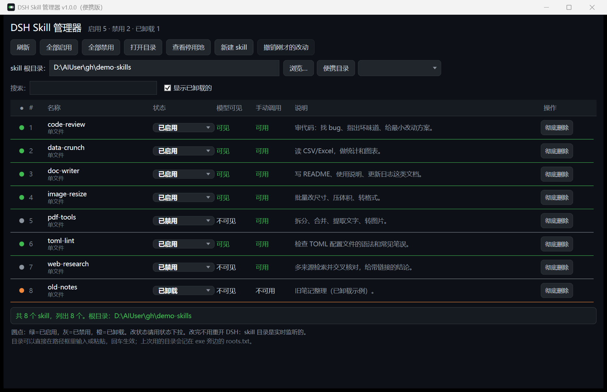

# DSH Skill 管理器（便携版）

给 DSH（DeepSeek Harness）的 skill 目录做一个图形界面：列出来、点一下切换「已启用 / 已禁用 / 已卸载」，改完立刻生效，不用重开 DSH。

- **单文件**：一个 `SkillManager.exe`，不装 .NET SDK、不装运行时补丁、不联网、不写注册表。
- **便携**：整个文件夹拷到哪都能用（U 盘、移动硬盘都行），删掉文件夹就等于卸载干净。
- **不碰你的 skill 内容**：只改 frontmatter 里的两个开关键，文件编码、正文、注释都原样保留。



> 截图里用的是示例 skill 和示例目录，方便看清三种状态；实际显示的是你自己的 skill。

---

## 下载与运行

1. 到 [Releases](../../releases) 下载最新的 `dsh-skill-portable-v1.0.0.zip`。
2. 解压到一个固定目录（**别在压缩包里直接双击**，那样 skill 会落在临时目录，关掉就没了）。
3. 双击 `SkillManager.exe`。

系统要求：Windows 10 / 11（自带 .NET Framework 4.x 即可）。不需要联网。

> exe 没有数字签名，首次运行 Windows SmartScreen 可能拦一下：点「更多信息」→「仍要运行」。
> 介意的可以自己按 [从源码构建](#从源码构建) 编译一份。

---

## 快速上手

第一次打开时，根目录是 exe 旁边的 `skills\`：Release 包里放了两个示例 skill（源码仓库里只有占位）。分两种情况：

**你已经有 DSH，想管理现有的 skill**

把 DSH 实际扫描的 skill 目录填进顶部「skill 根目录」那一行，回车：

```
C:\Users\<你的用户名>\.dsh\skills\        （全局）
<你的工作目录>\.dsh\skills\               （跟着项目走）
```

切过去之后会自动记住（记在 exe 旁边的 `roots.txt`），下次打开直接就是它。

**你还没有 DSH，只想先玩玩**

直接拿 `skills\` 练手：点「新建 skill」造几个，或者把 `examples\skills\` 里的两个示例复制进来。

---

## 三种状态

| 状态 | 对文件做了什么 | 模型能自动调用 | 你能 `/名字` 手动调用 |
| --- | --- | --- | --- |
| **已启用** | 两个开关键都不写（默认） | ✅ | ✅ |
| **已禁用** | `disable-model-invocation: true` | ❌ | ✅ |
| **已卸载** | `user-invocable: false` + 文件挪进 `skills\.disabled\` | ❌ | ❌ |

- 日常嫌 skill 太多太吵，用「已禁用」：模型看不见，但你想用时敲 `/名字` 还在。
- 「已卸载」是物理隐藏：DSH 不扫子目录，所以文件还在原地，只是彻底消失；想装回来切成别的状态即可。
- 「彻底删除」按钮才会真的删文件，删前会弹确认框。

改完**不需要重启 DSH**——skill 目录是实时监听的。

---

## skill 放在哪、长什么样

管理器管的是「根目录的第一层」：

```
skills\
  hello-skill.md          <- 单文件形态
  demo-bundle\
    SKILL.md              <- 目录式形态（同目录可以放参考文件和脚本）
  .disabled\              <- 停用池，程序自己管理，别手动往里放
```

单文件形态的最小写法：

```markdown
---
name: my-skill
description: 一句话说清什么时候该用它——DSH 主要靠这句判断要不要调用
---

在这里写完整说明。
```

`name` 和 `description` 缺任何一个都不会被 DSH 加载，管理器里会标红提醒。
目录式形态就是把上面的文件改名成 `<目录名>\SKILL.md`。

`examples\skills\` 里两个示例可以直接复制到根目录里试。

---

## 界面说明

| 位置 | 干什么 |
| --- | --- |
| 顶部标题旁 | 摘要：启用 / 禁用 / 已卸载各几个 |
| 工具栏 | 刷新、全部启用、全部禁用、打开目录、查看停用池、新建 skill、撤销刚才的改动 |
| 「skill 根目录」路径框 | 可以直接输入或粘贴路径，回车切换；Esc 放弃修改；目录不存在会问要不要创建 |
| 浏览… | 系统文件夹选择框 |
| 便携目录 | 一键回到 exe 旁边的 `skills\` |
| 最近 | 下拉列出 `roots.txt` 里记过的目录，点一下就切 |
| 搜索 | 按名字 / 说明过滤 |
| 显示已卸载的 | 要不要把停用池里的也列出来 |
| 每行的状态下拉 | 改状态；左边的圆点只是指示灯（绿=启用，灰=禁用，橙=卸载），不能点 |
| 每行的「彻底删除」 | 真删文件，会二次确认 |

- **撤销**只记最近一次改动，批量操作不可撤销（一次动十几行，撤销该退到哪一步没有清楚的答案）。
- 批量改状态会先弹确认框；`broken`（frontmatter 缺 name/description）的文件会在说明列标红。

---

## 根目录是怎么定的

按这个优先级，先命中谁用谁：

1. `roots.txt` 第一行 —— 你上次在界面里选的目录（程序自动写，别手改也行）
2. `portable.txt` 第一行 —— 你想固定指到某个目录时，自己在 exe 旁边建一个
3. exe 旁边的 `skills\`
4. exe 自己所在的目录

想固定在某个 DSH 目录、又不想每次被「上次选择」覆盖，就建 `portable.txt`：

```
C:\Users\你的用户名\.dsh\skills
```

（`portable.txt` 也是纯文本，一行路径，`#` 开头算注释。）

---

## 命令行参数（排查用）

程序是 GUI 子系统（`/target:winexe`），不接控制台，所以结果写文件：

| 参数 | 作用 |
| --- | --- |
| `--version` | 把版本、编译时间、exe 路径、当前根目录写进 `version.txt` |
| `--selftest --out 报告.txt` | 跑内核自检（32 项断言：frontmatter 改写、状态识别、端到端、坏文件容错） |
| `--smoke --out 报告.txt` | 只搭界面、扫一遍目录就退出 |
| `--smoke --smoke-state --out 报告.txt` | 额外验证状态切换 + 撤销 |
| `--check-ui --out 报告.txt` | 真渲染一次窗口（挪到屏幕外），验证自绘下拉框能不能点开、禁用按钮是不是深色底 |
| `--echoargs` | 把收到的参数写进 `echoed-args.txt` |

分不清「是不是还在用旧版」时，先跑一次 `--version` 看编译时间。
崩溃时会在 exe 旁边留 `crash.txt`（只有异常类型和消息，没有调用栈）。

---

## 常见问题

**改了状态，DSH 里的 skill 列表没变？**
九成是根目录指错了。这个程序只管它界面上显示的那个目录，不会自己去找 DSH。把路径框指到 DSH 真正扫描的 `skills` 目录再改一次。

**怎么确认 DSH 到底扫哪个目录？**
看 DSH 自己的 skill 列表/配置里写的路径，通常是 `~/.dsh/skills` 或工作目录下的 `.dsh/skills`。两个都行的话，用其中一个当根目录即可（或者把另一个目录里的文件复制过去）。

**下拉框点不开、或者变成白底白字？**
那是旧版本的 bug，v1.0.0 已修（自绘模板 + `--check-ui` 回归检查）。如果你自己改过源码，跑 `--check-ui` 确认两个模板都正常。

**会不会把 skill 文件改坏？**
写文件是「先写临时文件再整体替换」，中途断电不会留下半截文件；编码和 BOM 按原文件保留，正文和其它 frontmatter 键一个不动。

**卸载和删除有什么区别？**
卸载 = 挪进 `.disabled\`，随时能切回来；删除 = 真删（文件或整个目录），不可恢复。

**它会收集信息 / 联网吗？**
不会。代码里没有网络调用、没写注册表、不读机器码或用户名。它只做两件事：读写你指定的 skill 目录，以及在 exe 旁边生成几个自己的文本文件（`roots.txt`、`crash.txt`、`version.txt`）。

**这些文件能删吗？**
能。`roots.txt` 删了回到 `skills\`；`crash.txt` 只有崩溃时才有；`version.txt` 只有跑 `--version` 时才有。

**贴 issue 前要注意什么？**
`roots.txt` / `version.txt` 里有你本机的绝对路径（含用户名），贴之前删掉那几行。

**能放 U 盘 / 多人共用吗？**
能。整个文件夹带走即可；给别人之前删掉 `roots.txt`，不然对方会看到你的路径。

---

## 从源码构建

需要 Windows + .NET Framework 4.x（Win10/11 自带；不用装 Visual Studio，也不用 .NET SDK）。

```bat
双击 src\build.cmd
```

产物是仓库根目录的 `SkillManager.exe`。脚本用的是系统自带的 `csc.exe`：

```
%SystemRoot%\Microsoft.NET\Framework64\v4.0.30319\csc.exe
```

（32 位系统会自动回退到 `Framework` 目录；找不到编译器时脚本会直接报错退出。）

`src\build.cmd` 刻意保持纯 ASCII、编译命令写成一行——cmd.exe 对中文和脱字符续行的处理都不可靠，别改成多行。

也可以手动编译：

```bat
csc.exe /nologo /target:winexe /codepage:65001 /out:SkillManager.exe ^
  /reference:System.dll /reference:System.Core.dll /reference:System.Xaml.dll ^
  /reference:PresentationCore.dll /reference:PresentationFramework.dll ^
  /reference:WindowsBase.dll /reference:System.Windows.Forms.dll ^
  /reference:System.Drawing.dll SkillManager.cs
```

WPF 程序集在 `Framework\v4.0.30319\WPF\` 里，不在 GAC，引用时注意路径。
源码是 UTF-8，`/codepage:65001` 保证在非中文系统上也不会把中文字符串读坏。

改过源码后建议至少跑一遍：

```bat
SkillManager.exe --selftest --out selftest.txt
SkillManager.exe --check-ui --out checkui.txt
```

---

## 目录结构

```
dsh-skill-portable/
├─ src/
│  ├─ SkillManager.cs     # 唯一源码（界面 + 内核 + 自检）
│  ├─ build.cmd           # 一键编译
│  └─ app.ico             # 程序图标（可选，删了也能编）
├─ examples/skills/       # 示例 skill（单文件 + 目录式各一个）
├─ docs/
│  ├─ screenshot.png
│  └─ DEVELOPMENT.md      # 设计说明与 WPF 踩坑记录，想改代码先看这个
├─ skills/                # 便携包里的 skill 目录（仓库里只占位）
├─ .github/workflows/build.yml
├─ README.md
├─ 使用说明.txt           # 给不看 Markdown 的人准备的纯文本速查版
├─ CHANGELOG.md
└─ LICENSE
```

运行时会在 exe 旁边生成 `roots.txt`（不提交，已在 `.gitignore` 里）。

---

## 打包发版（维护者）

```powershell
# 先编译：双击 src\build.cmd
$v = 'v1.0.0'
$pkg = ".\pkg\dsh-skill-portable-$v"
New-Item -ItemType Directory -Force "$pkg\skills" | Out-Null
Copy-Item .\SkillManager.exe, .\README.md, .\使用说明.txt, .\LICENSE, .\CHANGELOG.md $pkg
Copy-Item .\examples\skills\* "$pkg\skills\" -Recurse
Compress-Archive -Path .\pkg\* -DestinationPath ".\dsh-skill-portable-$v.zip" -Force
```

压缩包里**不要**带 `roots.txt`、`*.bak`、`crash.txt`、`version.txt`、`selftest.txt`——前两个会泄露本机路径/干扰使用，后几个是排查产物。

> `Compress-Archive` 不会打包空目录：`skills\` 里一定要放点东西（示例 skill），否则对方解压后没有这个目录。

---

## 许可

[MIT](LICENSE)
